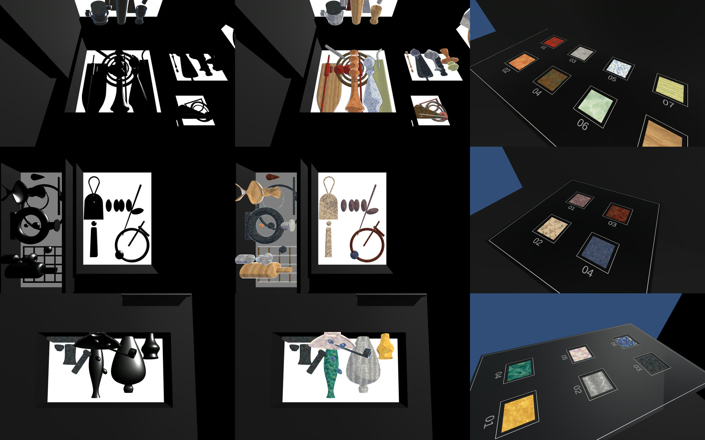

# 无限 · Unlimited

**VR 材质解谜游戏｜3 人小组，我负责核心开发｜2026.04 — 2026.06**

Unity 6 (URP) · XR Interaction Toolkit · OpenXR · HLSL / Shader Graph

玩家用射线照射器物，把写实材质化为工笔矿物质感；在塔内三个房间辨认 18 件器物，并把它们放回对应的槽位。一个房间的槽位全部放对后，整个房间的质地同时恢复，传送门随之打开。

这个项目在 Unity 里的全部实现由我完成，这个仓库整理了我在其中的技术工作。

---

## 分工

| 成员 | 负责内容 |
|---|---|
| **我** | 全部 Unity 开发：程序、着色器、交互；渲染与动画；约 1/3 的 Blender 建模 |
| 组员 A | 约 1/3 的 Blender 建模 |
| 组员 B | 约 1/3 的 Blender 建模 |

游戏中的器物与场景模型全部由小组自己建模。部分粒子、光束和体积雾特效来自第三方资源包。完整说明见 [分工与内容归属](docs/CREDITS.md)。

---

## 我做了什么

| # | 内容 | 说明 |
|---|---|---|
| 1 | **射线揭示着色器** | 手写 URP Shader，在同一个 pass 里计算工笔风格光照与 PBR，按脚本驱动的世界空间球体逐步揭示；包含描边、阴影和深度 pass |
| 2 | **VR 交互与谜题框架** | 射线照射、抓取、ID 槽位、错误反馈、缩略提示、完成演出、传送门转场；3 个房间共 18 件器物 |
| 3 | **三个尺度的视觉反馈** | 射线局部揭示 → 放对后缩小模型恢复 → 整房恢复，用明确的控制权避免几种效果互相覆盖 |
| 4 | **数据驱动的材质库** | 一个材质族 ID 同时决定器物材质、桌面样片、缩小模型和敲击声 |
| 5 | **ComfyUI × Unity 贴图流程** | 编辑器工具调用本地 ComfyUI，生成工笔底色与笔触贴图并自动回填；程序化种子图约束构图，每张图记录模型、提示词与种子，可复现 |
| 6 | **编辑器工具链** | 批量构建材质库、谜题布局与碰撞体，生成石台，审计场景配置，批量截图 |
| 7 | **自动化验证** | 4 组 PlayMode 测试，覆盖揭示、放置、整房恢复与三个房间的完成流程 |

---

## 文档

从 [开发文档首页](docs/README.md) 开始阅读，或按下表直接进入感兴趣的章节。

| 想了解什么 | 文档 |
|---|---|
| 整体架构、技术栈、代码规模 | [技术总览](docs/TECHNICAL.md) |
| 双表面揭示 Shader、描边、VR 接入 | [射线揭示着色器](docs/SHADER.md) |
| 射线、抓取、槽位、提示、传送门 | [交互与谜题流程](docs/INTERACTION.md) |
| 局部 → 单件 → 整房三层反馈 | [三个尺度的反馈](docs/FEEDBACK.md) |
| 一个 ID 驱动材质、样片和声音 | [数据驱动的材质库](docs/MATERIAL_LIBRARY.md) |
| ComfyUI 贴图生成与追溯 | [AIGC 贴图流程](docs/AIGC.md) |
| 编辑器工具 | [工具链](docs/TOOLS.md) |
| 测试、性能取舍与已知边界 | [验证与性能](docs/VALIDATION.md) |
| 方案怎么演变、哪些被放弃 | [开发迭代与后续计划](docs/REVIEW.md) |
| 谁做了什么、资源来源 | [分工与内容归属](docs/CREDITS.md) |

这个仓库只公开文档、截图和测试记录，Unity 工程与第三方资源不在其中；文中的代码是我为说明原理节选的片段。
