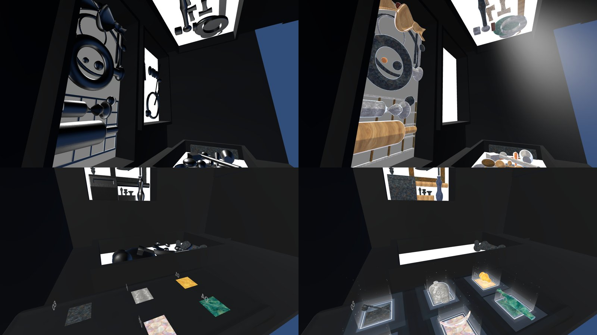

# 无限 · Unlimited

一个 VR 材质探索解谜项目的技术美术文档（Unity 6 · URP · XR Interaction Toolkit）。

玩家用射线照亮器物的一小块，看清它的真实质地、听到敲击声，再把器物放到对应质地的槽位上；全部放对后，整个房间的质地同时恢复。

## 文档

👉 **[技术美术开发文档](docs/Technical_Art_Development.md)**

## 亮点

- **双表面揭示 Shader**：手写 URP Shader，风格化光照与 PBR 在同一 pass 中按世界空间遮罩连续混合
- **空间一致的揭示**：世界空间定范围，物体空间定纹样，加三平面投影，抓取移动和双眼观察时保持一致
- **随揭示收缩的描边**：描边壳按揭示系数向内收缩，宽度按视深计算，左右眼一致
- **三个尺度的反馈**：局部探索 → 单件恢复 → 整房恢复，有明确的控制权划分
- **数据驱动的材质库**：一个材质族 ID 同时驱动器物、样片、缩小模型和声音
- **Unity 内的 AIGC 贴图管线**：编辑器直接调用 ComfyUI，自动平铺、写回配置并记录来源

> 本仓库只公开技术文档与截图，不包含工程源码与第三方资源。图中的 3D 模型与部分特效为第三方资源，详见文档末尾的《内容归属》。
