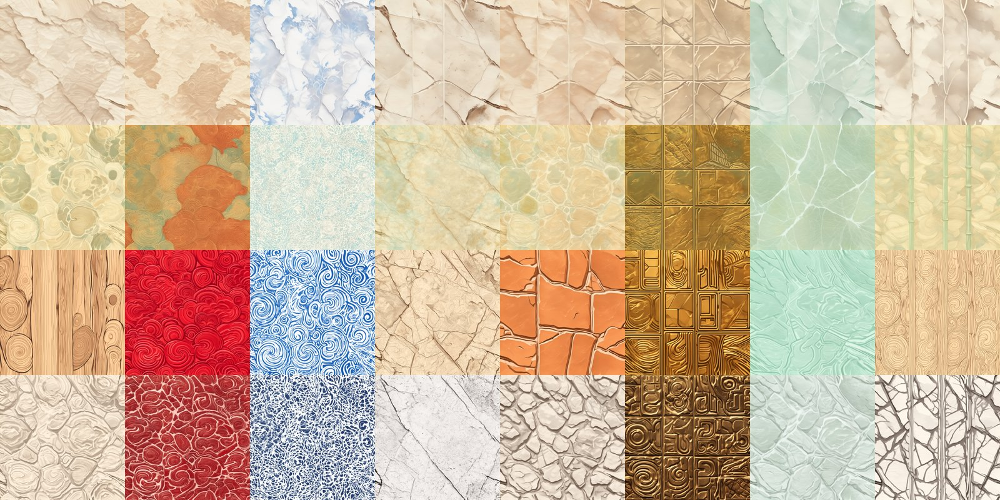

# ComfyUI × Unity 贴图流程

[← 文档首页](README.md) · 相关：[材质库](MATERIAL_LIBRARY.md) · [分工与内容归属](CREDITS.md)



## 1. 要解决的问题

三个房间需要大量风格统一的工笔底色和笔触贴图。手绘量太大；直接用网页工具生成，又要反复下载、改名、导入、连材质，也没法记录每张图是怎么来的。所以我把生成过程放进 Unity 编辑器：**选中材质 → 生成 → 自动回填**，每张图都附带完整的生成条件。

## 2. 两个阶段

| 阶段 | 入口 | 产出 |
|---|---|---|
| 风格探索 | Python 脚本，批量调用 ComfyUI | 「风格 × 质地」对比图，用来定方向，不进游戏 |
| 场景应用 | Unity 编辑器窗口 `Tools/Stylized Reveal/AI Texture Generator` 与批处理入口 | 生成贴图 → 平铺处理 → 导入 → 写回房间配置表 → 生成材质 → 截图 |

风格探索对比了水墨、工笔、木刻、拓印 4 种风格，以及木、漆、瓷、石、陶、铜、玉、竹 8 种质地，最终选定工笔矿物色方向。

## 3. 编辑器侧实现

| 模块 | 作用 |
|---|---|
| `ComfyClient` | 与本地 ComfyUI 通信：上传图片、提交队列、轮询、取回结果 |
| `StylizedRevealAiGenerator` | 在 C# 中按 ComfyUI 的 API 格式拼装工作流，支持 SD 1.5 与 Anima 两套底模；保存、导入、写来源记录 |
| `StylizedRevealAiStyles` | 风格预设：提示词、重绘幅度、笔触种子图类型 |
| `StylizedRevealAiWindow` | 编辑器窗口：选风格、底模、种子、重绘幅度，对选中材质生成 |
| `StylizedRevealAiBatch` | 批处理入口，不开编辑器界面也能生成贴图并截图 |
| `StrokeSeedPattern` | 程序化笔触种子图 |

我选择在代码里拼装工作流，而不是读取导出的 JSON 文件。这样底模、LoRA、种子、重绘幅度都是参数，切换底模不用维护两份工作流。

## 4. 笔触贴图：程序化种子图约束构图

直接文生图生成笔触纹理时，模型倾向于画出有主体的画面（铅笔、人物、手）。我的做法是**先用程序画出均匀的纹样骨架，再交给图生图加手绘质感**：

| 种子图类型 | 画法 | 用于 |
|---|---|---|
| `Hatch` | 两层方向交叉的排线，线长、间距、深浅都带随机 | 素描感 |
| `Brush` | 近似同向、粗细不一的长笔触 | 手绘、水墨 |
| `Dots` | 交错排列、大小缓慢起伏的网点 | 赛璐璐 |

**骨架保证纹样均匀、没有主体，AI 只负责笔触的不规则感。** 重绘幅度按风格设置（0.45 – 0.7）：太低时还是程序画的样子，太高时骨架被冲掉，主体又会出现。

种子图本身也由同一个种子驱动的随机数生成，所以同一个种子得到同一张种子图，整条链路可以重放。

## 5. 平铺处理

模型直接生成的图四边接不上。导入前我先做横向、再做纵向的处理：把图错开半幅，在靠近边缘的四分之一幅内淡入错开后的图。错开后的图在原来的边缘处是连续的，它自己的接缝落在画面中线，而中线处的权重为 0。

> 已知问题：过渡带里同一图案会出现两次。图案较大的漆、瓷类贴图能看出来，所以平铺接缝和实际观看尺度是单独的验收项。

## 6. 可复现：每张图的来源记录

每张生成图旁边都有同名 JSON。下面是一号房「竹」贴图的真实记录（提示词有删节）：

```json
{
  "generator": "ComfyUI (local)",
  "checkpoint": "anima-base-v1.0.safetensors",
  "lora": "texture-lora.safetensors @ 1",
  "style": "HandPainted",
  "prompt": "… texture, bamboo stalks side by side, yellow green bamboo with dark nodes, hand-painted surface texture, ink outlines, watercolor wash, … seamless tileable pattern, even lighting, top-down",
  "negativePrompt": "… text, watermark, signature, 1girl, 1boy, person, character, face, animal, object, scenery, landscape",
  "sourceTexture": null,
  "denoise": 1.0, "seed": 1007, "steps": 30, "cfg": 4.0, "size": 1024,
  "createdUtc": "2026-…",
  "postProcess": "edge cross-fade to make the image tile"
}
```

工程中共有 32 张生成贴图，每张都有来源记录；其中 14 份还附带完整的 ComfyUI 工作流，笔触贴图额外记录种子图类型（`seedPattern`）。用同样的底模和这份记录，就能重新生成同一张图。

反向提示词专门排除人物、动物、物体和风景，配合正向提示词里的 `top-down` 和 `even lighting`，让模型生成没有主体、没有透视、光照均匀的表面纹理。

- 游戏内一号房的 8 张质地贴图和风格探索图都是纯文生图（Anima + texture LoRA），不以任何第三方贴图作为输入；
- `sourceTexture` 字段用来标记图生图时参考了哪张图。以第三方贴图为输入的实验结果属于第三方素材的 AI 变体，只用于内部对比，不在本仓库公开，也不作为原创展示。

## 7. 回填

生成并完成平铺处理后，工具自动：

1. 按用途设置导入参数（颜色贴图开 sRGB，笔触贴图关 sRGB；统一用重复寻址）后导入；
2. 写回房间配置表中对应的材质族；
3. 调用材质库同步，更新器物、样片和缩小模型的材质；
4. 按「未揭示 / 过渡 / 已揭示」批量截图，作为版本对照。

从生成到能在场景里看到效果不需要手动操作，所以可以快速比较不同的种子和风格。
