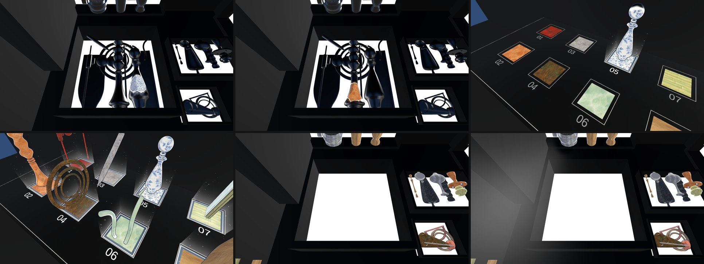
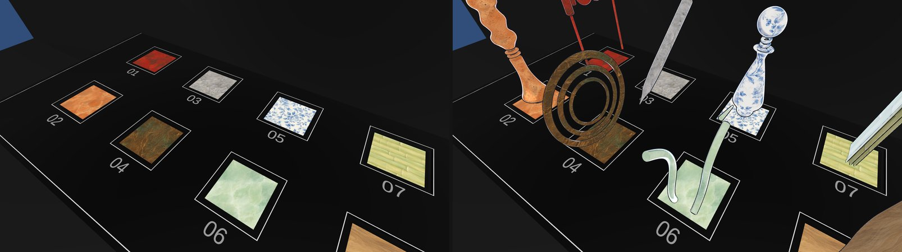

# 三个尺度的反馈

[← 文档首页](README.md) · 相关：[着色器](SHADER.md) · [交互与谜题流程](INTERACTION.md)

| 尺度 | 玩家行为 | 视觉反馈 | 组件 |
|---|---|---|---|
| 局部 | 射线照到器物 | 光斑处露出另一种表面，离开后退回 | `RevealPatchDriver` |
| 单件 | 器物放对槽位 | 槽位上的缩小模型从中心铺开并保持 | `RevealSlotSwatch` |
| 整房 | 全部槽位正确 | 房间里所有揭示物体同时恢复 | `RevealRoomFinale` |

三个组件写的是同一组 Shader 属性（`_HitPosWS` / `_Radius` / `_Softness`）。这一章的核心是**控制权**：任何时刻，一个 Renderer 只由一个组件控制。

## 1. 局部探索：以整件器物为单位

`LaserMaterialSpreadPhysics` 以单个零件为单位工作：射线换到另一个零件时从零开始，滑到另一件器物时，前一件会停在原样。`RevealPatchDriver` 在它之后的 `LateUpdate` 中接管同一组属性：

- 以器物根节点为键，把多个零件的 Renderer 归到同一条记录，在零件之间移动不会重来；
- 半径用 `SmoothDamp` 趋近目标值，起步快、收尾慢，消退也一样；
- 球心带一点延迟跟随落点，光斑在表面上「滑动」，而不是跳动；
- 射线离开后，无论移到哪里，旧区域都会退回；半径小于 0.004 m 时清理属性块和记录。

| 参数 | 默认值 | 作用 |
|---|---:|---|
| `growTime` | 0.22 s | 半径生长的平滑时间 |
| `fadeTime` | 0.30 s | 离开后消退的平滑时间 |
| `followTime` | 0.10 s | 球心跟随落点的平滑时间 |
| `softness` | 0.30 m | 过渡带宽度 |

接管而不是改写原脚本，是为了保留原脚本的声音播放和命中检测，同时只替换表现层。

## 2. 单件答案：缩小模型恢复

器物放对后，`RevealSlotSwatch` 把槽位上的缩小模型换成该器物的揭示材质，从展示中心铺开，并保持不再消退。

复杂器物由几段组成，如果只按最大那段的包围盒计算半径，最远那段会停在揭示前的样子。所以最大半径取「展示中心到合并包围盒八个角的最远距离」，再加上过渡带和噪声余量。

## 3. 整房完成：明确控制权

`RevealRoomFinale` 在房间完成后，收集房间内所有使用揭示 Shader 的 Renderer，让每件物体从自己的包围盒中心同时铺开，并用 SmoothStep 缓动。

- 整房恢复把接管的物体登记到静态集合 `Driven`，局部探索遇到这些物体时直接跳过，射线消退不会覆盖已完成的恢复；
- 整房恢复主动排除槽位上的缩小模型，保留它们的独立反馈；
- 房间范围同时参考层级（是否在房间根节点下）和房间盒。房间盒运行时可能被禁用，禁用后 `bounds` 会变成原点处的空盒，所以改用盒子的中心、尺寸和变换自行计算；
- 其他房间尚未解开的谜题器物不会被提前恢复。

> 边界：房间范围计算假设房间盒没有旋转。

## 4. 控制权一览

| 状态 | 局部探索 | 单件反馈 | 整房恢复 |
|---|---|---|---|
| 器物在架子上，未完成 | **控制** | — | — |
| 器物放对，缩小模型出现 | 跳过（原器物已隐藏） | **控制缩小模型** | — |
| 房间完成 | 跳过 `Driven` 中的物体 | **继续控制缩小模型** | **控制其余揭示物体** |
| 其他房间的器物 | **控制** | — | 不接管 |

这张表也是 PlayMode 测试的检查点，见 [验证](VALIDATION.md)。
