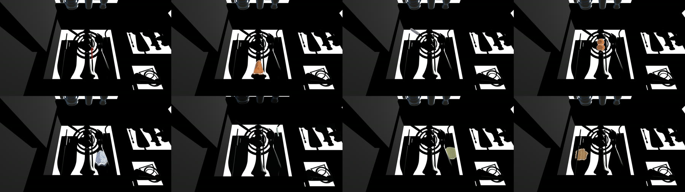
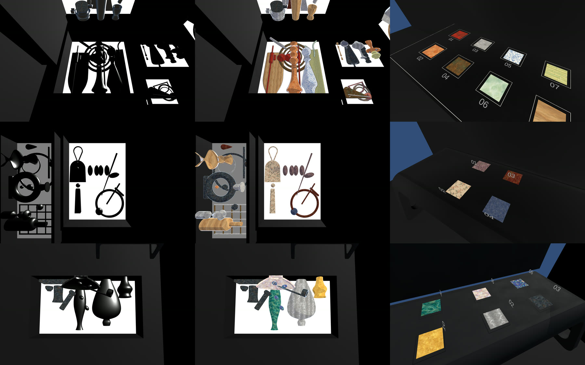

# 交互与谜题流程

[← 文档首页](README.md) · 相关：[三个尺度的反馈](FEEDBACK.md) · [技术总览](TECHNICAL.md)

这一章是我写的交互和谜题框架：射线照射、抓取、ID 槽位、错误反馈、缩略提示、完成演出和传送门转场。三个房间共 18 件可抓取器物，都建立在这套框架上。揭示 Shader 和三个尺度的视觉反馈接在它上面，见 [着色器](SHADER.md) 和 [反馈](FEEDBACK.md)。



## 1. 设计约束

- **VR 里手比眼睛慢**：线索必须远距离就能获取，所以「看质地」交给射线，「做答案」才需要走过去抓取；
- **答错要立刻知道，但不能卡住**：错误反馈要即时、明确，并且把器物弹回玩家能再次拿到的位置；
- **每个房间规模不同**（8 / 4 / 6 件）：框架不能写死数量，要能自动发现槽位；
- **场景切换不能晕**：VR 里瞬移必须配合黑场和声音过渡。

## 2. 射线照射：看质地、听质地

| 组件 | 作用 |
|---|---|
| `LaserMaterialSpreadPhysics` | 从手柄发出射线；命中后把落点、半径、软边写进揭示 Shader；离开后半径回退 |
| `RayHoverSurfaceAudio` | 射线在同一表面停留 0.5 s 后播放该材质的敲击声，最长 1.5 s，冷却 0.3 s |
| `MaterialAudioMap` | ScriptableObject：材质 → 声音，支持按引用或按清理后的材质名查找 |
| `SurfaceAudioTag` | 单个物体的声音覆盖 |
| `MaterialAudioResolver` | 先查覆盖标签，再查映射表，统一声音查找入口 |

射线命中时找到真正被照到的 Renderer（多零件器物需要向上、向下查找），用 `MaterialPropertyBlock` 写参数，不复制材质。最大半径默认按包围盒自动计算，也可以手动指定。

我让射线停留 0.5 s 才出声，是为了防止射线扫过一排器物时连续响一串声音。玩家需要「停下来看」，才会得到「这是什么」的回答。

后来做三个尺度的反馈时，我用 `RevealPatchDriver` 在 `LateUpdate` 里接管这部分，改成以整件器物为单位、平滑生长与消退，见 [反馈 · 局部探索](FEEDBACK.md#1-局部探索以整件器物为单位)。

## 3. 抓取：统一手感

器物尺寸从小勺到大瓶差异很大，直接抓取时有的挡住视线，有的小到看不清。我用三个组件统一抓取时的手感：

| 组件 | 作用 | 默认值 |
|---|---|---|
| `ScaleToSizeOnGrab` | 抓起时按 Renderer 包围盒最长边，统一缩放到固定尺寸 | 12 cm |
| `SnapToHandOnGrab` | 抓起时吸附到手柄前方，便于翻看 | 前 30 cm，上 3 cm |
| `GrabbableStartFrozenThenGravity` | 开局冻结（摆放稳定），第一次被抓起后才启用重力 | — |
| `ReturnHome` | 记录初始位置、旋转和缩放，可以复位 | — |

`GrabbableStartFrozenThenGravity` 是为了解决我遇到的一个实际问题：几十件器物开局如果都带物理，会在加载时互相挤压、滚落。冻结到第一次抓取，既保证初始摆放，又让松手后的器物有真实的下落。

刚体要求凸碰撞体，复杂器物的碰撞体由我写的编辑器工具按零件切块后生成凸包，见 [工具链](TOOLS.md)。

## 4. ID 槽位：只接受对的答案

```text
器物  PuzzleItemId.itemId = "R1_07"
                 │
槽位  PuzzleSocketInteractor（继承 XRSocketInteractor）
        CanHover():  allowHoverWhenWrong ? true : IsMatch()
        CanSelect(): IsMatch()           ← 错的器物永远不会被吸入
                 │
      PuzzleSlotMiniature（正确时）            PuzzleSlotErrorFeedbackKick（悬停但不匹配时）
```

- `IsMatch` 在器物自身和父级上查找 `PuzzleItemId`，比较时不区分大小写，多零件器物抓任一零件都能识别；
- `CanSelect` 只放行匹配的器物，所以错误答案不会被「吸住」；
- 需要错误反馈的槽位打开 `allowHoverWhenWrong`，让错误器物能触发悬停事件，但仍然不能被选中。

## 5. 放对：缩小模型与锁定

`PuzzleSlotMiniature` 在正确选中时：

1. 标记 `IsCorrect`，调用 `PuzzlePlacedLock.LockNow()`，禁用原器物的抓取、碰撞和渲染；
2. 在槽位的展示点生成该器物的**缩小模型**，并把它抬到槽面上方 2 mm（`miniClearance`），避免穿模；
3. 关闭缩小模型的物理，切换槽位的发光材质；
4. 通知 `RoomPuzzleManager` 检查整房进度。

`SlotCompletionFX` 在槽位第一次变为正确时，在槽位上播放一次特效。之后，`RevealSlotSwatch` 让缩小模型从中心铺开、恢复真实质地，见 [反馈 · 单件答案](FEEDBACK.md#2-单件答案缩小模型恢复)。

## 6. 放错：三重即时反馈

`PuzzleSlotErrorFeedbackKick` 监听槽位的悬停事件，错误器物一靠近就反馈：

| 反馈 | 实现 | 参数 |
|---|---|---|
| 视觉 | 槽位发光材质切到红色 | 0.15 s |
| 听觉 | 3D 空间化的错误音 | 冷却 0.6 s，避免连响 |
| 物理 | 沿槽位正方向加冲量，并带一点向上的分量，把器物弹开 | 冲量 1.2，向上 0.15 |

我把反馈分成三个通道：看着槽位的玩家看到红光，没看着的玩家听到声音，手上的感觉是器物被推开。器物被弹开后受重力落在桌边，玩家可以直接再捡起来。

## 7. 缩略提示：告诉玩家还差什么

框架提供了两种缩略提示：

- **缩略图海报**：桌后的海报用白色线框画出每件器物的轮廓缩略图，编号与槽位对应。`Room01PosterProgressDisplay` 以 0.1 s 间隔检查 8 个槽位，每放对一个，海报上对应的缩略图高亮，槽位标签变色。它按命名规则自动找到槽位和高亮物体，场景结构调整后不用重新拖引用。
- **桌面样片**：每个槽位下方有一块质地样片，告诉玩家这个位置要什么质地。样片材质与器物的揭示材质来自同一个材质族，见 [材质库](MATERIAL_LIBRARY.md)。

**提示的演变：从形状到质地。** 轮廓缩略图让玩家可以直接照着形状找器物，不用射线去看质地，核心机制就被绕过了。所以在加入材质揭示之后，我用编辑器工具把三个房间的轮廓海报统一关闭，**槽位只用质地样片提示**（见 [工具链](TOOLS.md) 与 [开发迭代](REVIEW.md)）。



最终的谜题是**质地配对**：射线让玩家看到并听到器物的真实质地，样片告诉玩家每个槽位要什么质地，两者对上才是正确答案。

## 8. 房间完成：演出与传送门

`RoomPuzzleManager` 自动收集子物体中的所有槽位，每次槽位状态变化时检查是否全部正确。全部正确后：

```text
锁定所有槽位
 → 等待 delayBeforeAnimation
 → RoomCompletionSequence.PlayRoutine()
      ├─ 完成音乐
      ├─ 灯光与环境光压暗（1.8 s，缓动）
      ├─ 光柱从 0 长到原尺寸，同时渐显（0.2 s 后开始，3.65 s）
      ├─ 传送门出现，粒子重新播放，缩放渐显（0.3 s 后开始，1.2 s）
      └─ 启用传送触发器和 RoomExitTeleportXR
 → RevealRoomFinale：整房质地恢复（见反馈章节）
```

`RoomCompletionSequence` 在 `Awake` 时记录灯光、环境光、光柱和传送门的初始状态，可以随时恢复，PlayMode 测试和反复调试时都依赖这一点。

我压暗灯光，是为了让光柱和传送门成为视觉焦点。也正因为这样，揭示 Shader 和环境 Shader 都有 `_ToonSelfLight` 下限，保证灯暗下来时房间仍然看得清。

## 9. 传送门转场

`RoomExitTeleportXR` 处理玩家走进传送门后的转场：

```text
进入触发区（或按确认键）
 → 停止完成音乐；AudioMixer 切到传送快照，同时屏幕在 0.3 s 内转黑
 → TeleportationProvider 把玩家移到下一个房间的入口
 → RoomLimiter 切换到新房间的边界盒
 → 等待 0.12 s；AudioMixer 切回正常快照，屏幕在 1.0 s 内恢复
```

- **黑场**：运行时自动创建全屏遮罩，不依赖场景里事先摆好的 UI；
- **声音**：`TeleportBGMFade` 在两个 AudioMixer 快照之间交叉淡化，比直接改音量更平滑；
- **边界**：`RoomLimiter` 把角色控制器限制在当前房间的边界盒内（离墙 0.15 m），换房间时切换边界盒，防止玩家走出房间或穿墙看到下一个房间；
- **冷却**：0.5 s，防止在触发区边缘反复进出导致连续传送。

开始场景和塔外场景之间的切换由注视停留（`CameraDwellLoadScene`，看向目标约 1 s）和触发器加载（`LoadSceneOnTrigger`）完成，玩家进塔后由 `XRSpawnOnSceneLoad` 放到出生点。

## 10. 扩展性

| 需求 | 做法 |
|---|---|
| 新增一个房间 | 复制房间根节点；`RoomPuzzleManager` 自动发现槽位；配一张 `RevealPuzzleTable` |
| 新增一对器物和槽位 | 给器物加 `PuzzleItemId`，槽位填同一个 ID；运行谜题构建工具生成材质、样片与缩小模型 |
| 换一种质地 | 只改材质库，不改判定逻辑 |

三个房间的谜题布局、碰撞体和材质都由编辑器工具批量构建，见 [工具链](TOOLS.md)。
