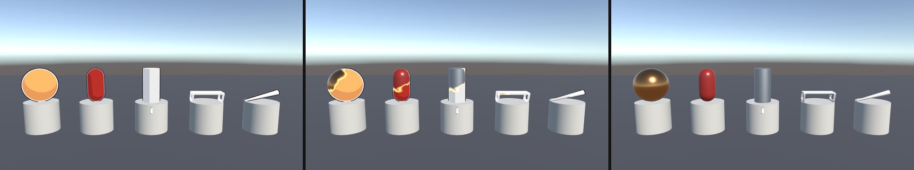

# 无限 · 开发文档

[← 项目首页](../README.md)

这份文档记录我在《无限》里做的开发工作：怎样让「材质变化」成为解谜线索，怎样用一个 Shader 同时承载风格化和写实两种表面，怎样把射线、抓取、槽位和传送门串成三个房间的完整流程，以及怎样用材质库、AIGC 贴图流程和编辑器工具让三个房间可以批量搭建。

> 技术基线：Unity 6000.0.59f2 · URP 17.0.4 · XR Interaction Toolkit 3.3.0 · OpenXR 1.15.1
> 项目周期：2026.04 — 2026.06｜文档版本 3.0

## 阅读路线

建议先读 [技术总览](TECHNICAL.md)，再按兴趣进入具体章节。

| 想了解什么 | 章节 |
|---|---|
| 整体架构、模块关系、代码规模、技术栈 | [技术总览](TECHNICAL.md) |
| 同一几何上的两种表面、揭示遮罩、描边、VR 接入 | [射线揭示着色器](SHADER.md) |
| 射线照射、抓取、ID 槽位、错误反馈、缩略提示、完成演出、传送门 | [交互与谜题流程](INTERACTION.md) |
| 局部探索、单件恢复、整房恢复怎样分配控制权 | [三个尺度的反馈](FEEDBACK.md) |
| 一个材质族 ID 驱动器物、样片、缩小模型和声音 | [数据驱动的材质库](MATERIAL_LIBRARY.md) |
| 编辑器调用 ComfyUI、种子图约束、平铺处理、来源记录 | [AIGC 贴图流程](AIGC.md) |
| 材质库构建、谜题布局、碰撞体、石台、审计、截图 | [工具链](TOOLS.md) |
| PlayMode 测试、性能取舍、已知边界 | [验证与性能](VALIDATION.md) |
| Shader Graph 到手写 HLSL、被放弃的方案、后续计划 | [开发迭代与后续计划](REVIEW.md) |
| 分工、模型与特效来源 | [分工与内容归属](CREDITS.md) |
| 截图、测试记录、审计输出 | [实现与测试资料](evidence/README.md) |

## 一页看懂

| 尺度 | 玩家行为 | 视觉反馈 | 承载的信息 |
|---|---|---|---|
| 局部 | 射线照到器物 | 光斑处露出另一种表面，伴随敲击声；离开后退回 | 这件器物是什么质地 |
| 单件 | 器物放对槽位 | 槽位上的缩小模型从中心铺开，恢复真实质地并保持 | 这个答案是对的 |
| 单件 | 器物放错槽位 | 槽位闪红、错误音、器物被弹开 | 这个答案不对 |
| 整房 | 全部槽位正确 | 灯光压暗、光柱升起、整房质地恢复、传送门打开 | 房间完成，可以前进 |

三个房间分别有 8、4、6 件器物，共 18 件。
