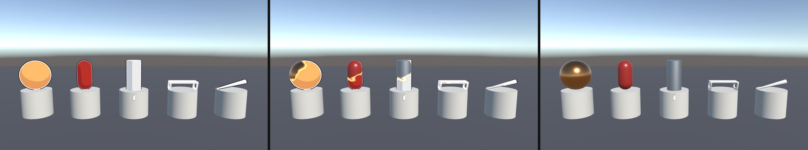

# 射线揭示着色器

[← 文档首页](README.md) · 相关：[三个尺度的反馈](FEEDBACK.md) · [开发迭代](REVIEW.md)



## 1. 要解决的问题

这个游戏用材质变化作为解谜线索。所以 Shader 不只负责好看，还要传递信息：

- 同一件器物上要同时存在两种表面：**工笔矿物风格**（未揭示）和**写实 PBR**（已揭示），两者之间要能连续过渡；
- 揭示的范围由射线落点决定，必须是一个**三维空间里的区域**，而不是屏幕上的一个圆；
- 器物由多个零件组成，会被玩家抓起、移动、缩放，两只眼睛分别渲染，揭示效果在这些情况下都要保持一致；
- 风格化的一侧需要描边，描边要跟着揭示边界一起退去。

## 2. 第一版：Shader Graph 原型

第一版用 Shader Graph 搭建（`Blend.shadergraph`），验证玩法是否成立：

```text
Position(World) ─▶ Subtract(_HitPosWS) ─▶ Length ─▶ Smoothstep(_Radius - _Softness, _Radius) ─▶ One Minus = mask
A 组 PBR 贴图（Base / Mask / Roughness）─┐
B 组 PBR 贴图（Base / Mask / Normal）   ─┴─▶ Lerp(mask) ─▶ BaseColor / Metallic / Smoothness / Normal
```

脚本（`LaserMaterialSpreadPhysics`）每帧把射线落点和半径写进 `_HitPosWS` / `_Radius` / `_Softness`。这一版证明了「世界空间球形遮罩 + 脚本驱动半径」能用，后续版本沿用了这三个属性名，所以原有的射线脚本不用修改。

它的局限也在原型阶段暴露出来：两侧都是 PBR，差别只有贴图，读不出「两种质感」；Shader Graph 无法加自定义的阶梯光照，也无法加一个随揭示边界裁切的描边 pass。于是第二版改为手写 HLSL，原因记录在 [开发迭代](REVIEW.md)。

## 3. 第二版：手写 URP Shader

### 3.1 结构

| Pass | 作用 |
|---|---|
| `ForwardLit` | 在同一个片元里分别计算风格化光照和 PBR，按揭示系数混合 |
| `Outline` | 法线外扩描边壳，只属于风格化一侧，随揭示收缩 |
| `ShadowCaster` | 阴影 |
| `DepthOnly` | 深度预渲染 |
| `DepthNormals` | 给 SSAO 等屏幕空间效果提供法线 |

代码拆成 `Input`（属性与揭示函数）、`Lighting`（风格化光照）、`ForwardPass`、`OutlinePass`、`DepthPasses` 五个 `.hlsl` 文件。揭示函数只写一次，所有 pass 共用，保证颜色、描边、阴影看到的是同一个揭示边界。所有材质参数放在同一个 `UnityPerMaterial` 常量缓冲中，与 SRP Batcher 兼容。

### 3.2 同一套几何上的两种表面

```hlsl
// 揭示侧：URP 标准金属度 PBR
half3 pbr  = UniversalFragmentPBR(inputData, surfaceData).rgb;
// 未揭示侧：默认使用平滑的几何法线，保持完整的色块
inputData.normalWS = normalize(lerp(geoNormalWS, detailNormalWS, _ToonNormalInfluence));
half3 toon = StylizedLighting(inputData, toonAlbedo, stroke);

half3 color = lerp(toon, pbr, reveal.reveal) + _EdgeColor.rgb * reveal.glow;
```

**PBR 侧**：底色、切线空间法线、遮罩贴图（R 金属度 / G 遮蔽 / A 光滑度）。为兼容第一版的材质，也可以从独立的粗糙度贴图读取，用 `1 - roughness` 转成光滑度。

**风格化侧**：

- Half-Lambert 加阶梯量化（`_RampSteps` 档数、`_RampSmooth` 档间软硬），也可以换成 Ramp 贴图；
- 暗部颜色（`_ShadeColor`）单独指定，形成工笔画里偏冷的阴影色；
- 环境光只取球谐 L0，让暗部保持单一干净的色调；
- 硬边高光只出现在亮部；边缘光可以部分跟随主光方向（`_RimLightAlign`）；
- **笔触贴图不直接叠加颜色，而是偏移明暗阈值**，让笔触体现在明暗交界的形状上，而不是像一层贴纸；
- 附加光源同样按档量化，兼容 Forward+ 的光源循环；
- `_ToonSelfLight` 保证完成演出压暗灯光时，风格化表面仍然看得清。

`_RevealToStylized` 可以反转揭示方向：既可以从风格化揭示成 PBR，也可以从 PBR 揭示成风格化。第一版场景里的金属材质迁移过来时，就是用反向模式保留原有外观。

### 3.3 世界空间定范围，物体空间定纹样

```hlsl
float grow  = saturate(_Radius / soft);   // 半径为 0 时，噪声和发光也为 0
float noise = 三层不同频率的 3D 值噪声(patternPos);
float dist  = distance(positionWS, _HitPosWS.xyz) + noise * _EdgeNoiseStrength * grow;
float inside = (1 - smoothstep(_Radius - soft, _Radius, dist)) * step(1e-5, _Radius);
```

- **范围用世界空间**：射线落点就是球心。同一件器物的多个零件共用一个球，切换零件时不会出现断层。
- **纹样用物体空间**：`GetPatternPosition` 从模型矩阵提取三个轴的缩放，乘回局部坐标，把物体空间换算成米。这样边缘噪声、笔触和三平面贴图都跟着物体移动，不同缩放的物体上密度也接近。
- **初始状态干净**：噪声强度和发光带都乘以 `grow`，半径为 0 时完全没有残留。
- **过渡带有发光**：`_EdgeColor`（HDR）勾出揭示的前沿，让玩家看清「正在变化」的位置。

### 3.4 三平面投影，摆脱 UV

风格化底色和笔触都支持三平面采样：底色用法线四次方作权重，过渡更硬，不容易糊；笔触用法线平方作权重，过渡更柔和。三组模型来自不同组员，UV 的展开方式和密度不一样，三平面投影让它们能套用同一种材质语言，纹素密度也保持一致。

### 3.5 随揭示收缩的描边

```hlsl
float eyeDepth = -TransformWorldToView(positionWS).z;   // 用视深，而不是到眼睛的距离
float width = _OutlineWidth * 0.001 * lerp(1.0, clamp(eyeDepth, 0.25, 8.0), _OutlineScreenSpace);
width *= 1.0 - ComputeReveal(positionWS, patternPos).reveal;   // 揭示处，壳收回表面
...
clip(0.5 - ComputeReveal(input.positionWS, input.patternPos).reveal);   // 片元阶段再裁一次
```

- 揭示系数在**未外扩的原表面**上计算，所以描边的裁切位置与表面的揭示边界对齐；
- 宽度用视深而不是到相机的距离，左右眼的外扩量一致，避免 VR 中两只眼睛看到的描边粗细不同；
- `_OutlineScreenSpace` 在「固定世界宽度」和「随距离保持屏幕宽度」之间调节。

### 3.6 VR 接入

顶点和片元结构都带实例 ID 和立体渲染宏（`UNITY_VERTEX_OUTPUT_STEREO`、`UNITY_SETUP_STEREO_EYE_INDEX_POST_VERTEX`），所有 pass 都支持 GPU Instancing。纹样来自物体空间，范围来自世界空间，左右眼看到的是同一个三维效果，而不是各自的屏幕空间效果。

> 边界：以上是代码层面的接入措施，项目在 XR 模拟器中验证过。双眼一致性、边缘闪烁和帧耗时仍需要在真机上实测。

## 4. 环境 Shader：`Gongbi Environment`

墙面、地面、桌子等不参与揭示的环境物体，用一个轻量的 Shader，和器物共用同一套矿物色贴图：

- 世界空间三平面投影（法线四次方权重），按「每米几块」设置密度，大面积墙面也不需要展 UV；
- 主光用 `smoothstep` 做一次柔和的两档明暗，环境光用球谐；
- 同样有 `_ToonSelfLight` 下限，完成演出压暗灯光时环境不会全黑；
- 包含 `DepthOnly`、`ShadowCaster`，支持 GPU Instancing 和立体渲染。

器物用功能完整的揭示 Shader，环境用这个只有一次三平面采样的 Shader，把片元开销集中在玩家真正注视的物体上。

## 5. 参数分组

| 分组 | 主要参数 | 由谁写入 |
|---|---|---|
| 揭示 | `_HitPosWS` `_Radius` `_Softness` `_RevealToStylized` | 运行时脚本（属性块） |
| 揭示边缘 | `_EdgeNoiseScale/Strength/Speed` `_EdgeWidth` `_EdgeColor` | 材质 |
| PBR 侧 | `_BaseMap` `_BumpMap` `_MaskMap` `_RoughnessMap` | 材质库同步 |
| 风格化侧 | `_ToonMap` `_ShadeColor` `_RampSteps/Smooth/Offset` `_ToonSelfLight` | 材质库同步 + 房间参数 |
| 高光与边缘光 | `_ToonSpecColor` `_SpecSize` `_RimColor` `_RimThreshold` `_RimLightAlign` | 材质 |
| 笔触 | `_StrokeTex` `_StrokeScale` `_StrokeStrength` | AIGC 生成后回填 |
| 描边 | `_OutlineColor` `_OutlineWidth` `_OutlineScreenSpace` | 材质 |

可选功能用 `shader_feature`（`_TOON_TRIPLANAR`、`_STROKE_TEX`、`_RAMP_TEX`、`_ROUGHNESS_MAP`）开关，不用的功能不产生变体开销。
