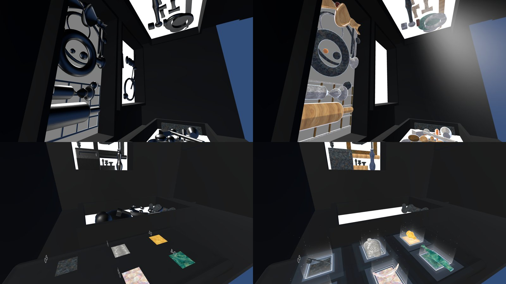
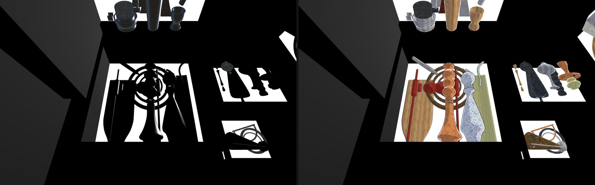
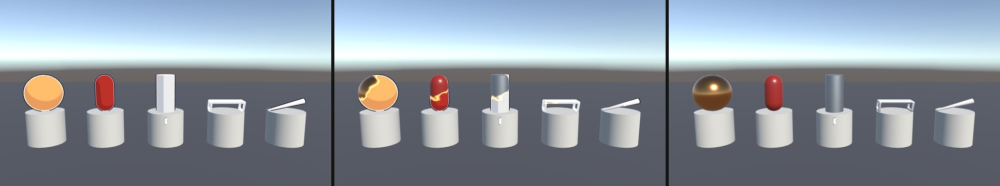
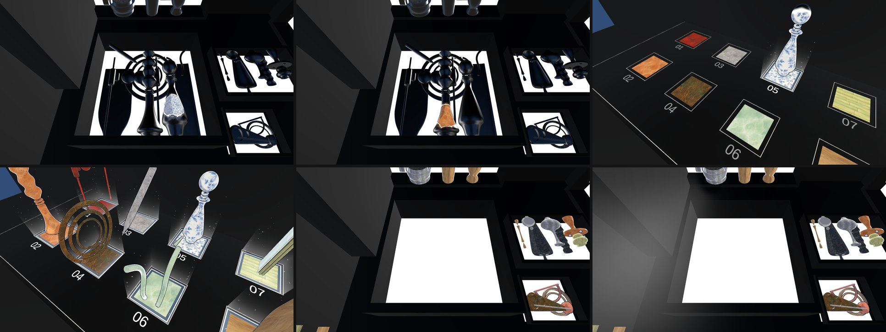
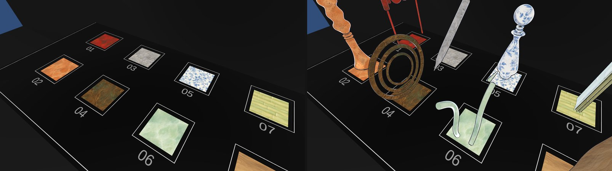
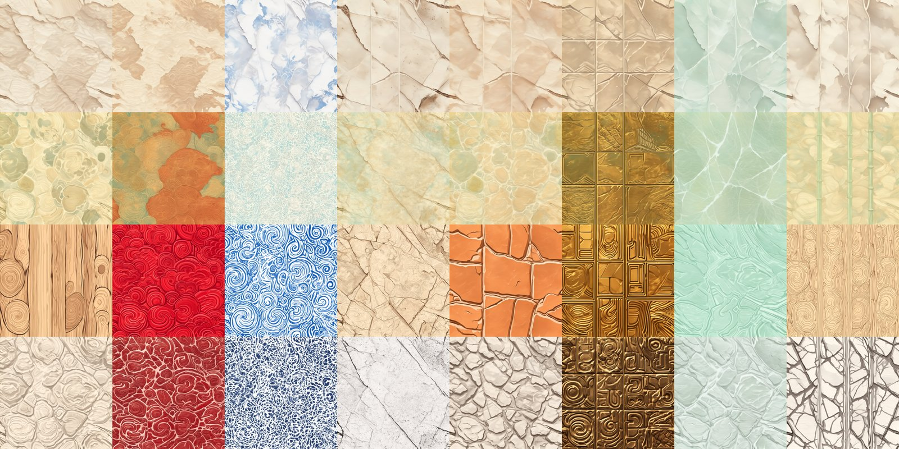

# 无限｜VR 材质探索解谜 · 技术美术开发文档

> 技术基线：Unity 6000.0.59f2 · URP 17.0.4 · XR Interaction Toolkit 3.3.0 · OpenXR 1.15.1
> 文档版本：2.0｜2026-11-06
> 说明：本文只公开技术设计与关键代码片段，工程本身不公开。图中的 3D 模型、场景结构、粒子与光束特效来自第三方资源或项目原有内容，见文末《内容归属》。



---

## 亮点速览

| # | 亮点 | 一句话说明 |
|---|---|---|
| 1 | **双表面揭示 Shader** | 手写 URP Shader，同一个 pass 内计算风格化光照与 PBR，按世界空间球形遮罩连续混合，方向可以反转 |
| 2 | **空间一致的揭示** | 揭示范围用世界空间，纹样用经缩放补偿的物体空间，再加三平面投影，抓取移动和双眼观察时效果保持一致 |
| 3 | **随揭示收缩的描边** | 描边壳按揭示系数在顶点阶段向内收缩，片元阶段再裁掉一次；宽度用视深计算，左右眼一致 |
| 4 | **三个尺度的反馈** | 射线局部探索 → 放对后缩小模型恢复 → 整房恢复，用明确的「控制权」避免几种效果互相覆盖 |
| 5 | **数据驱动的材质库** | 一个 `familyId` 同时决定器物材质、桌面样片、缩小模型和敲击声 |
| 6 | **Unity 内的 AIGC 贴图管线** | 编辑器直接调用 ComfyUI，生成后自动做平铺处理、写入配置，每张图附带来源记录 |
| 7 | **编辑器工具链 + 自动化验证** | 场景转换、凸包碰撞体、程序化石台、只读审计，加 4 组 PlayMode 测试 |

---

## 01 · 设计目标：让材质成为线索

我把这个项目的技术美术方向定为「以材质变化驱动探索」。玩家用射线照亮器物的一小块，观察它的真实质地并听到敲击声，再把器物放到对应质地的槽位上。全部放对后，整个房间的质地同时恢复。

所以 Shader 不只负责好看，还要传递信息：

| 尺度 | 玩家行为 | 视觉反馈 | 承载的信息 |
|---|---|---|---|
| 局部 | 射线照到器物 | 光斑处露出另一种表面，离开后退回 | 这件器物是什么质地 |
| 单件 | 器物放对槽位 | 槽位上的缩小模型从中心铺开并保持 | 这个答案是对的 |
| 整房 | 全部槽位正确 | 房间里所有揭示物体同时恢复 | 房间完成，可以前进 |

我要解决的核心问题：

- 风格化表面和 PBR 表面怎样在同一物体上连续过渡；
- 揭示效果在多零件器物、抓取移动和双眼观察下怎样保持空间一致；
- 器物、样片、缩小模型和声音怎样共用一套配置；
- 多个房间怎样复用同一套表现系统，同时保留各自的材质与谜题。



---

## 02 · 系统划分

| 层级 | 组件 | 职责 |
|---|---|---|
| 渲染 | `DUIZHAO/Stylized Reveal` Shader（5 个 pass） | 风格化光照、PBR、空间遮罩、描边、阴影与深度 |
| 局部探索 | `RevealPatchDriver` | 以整件器物为单位管理揭示区域的生长、跟随与消退 |
| 单件反馈 | `RevealSlotSwatch` | 放对后接管缩小模型，铺开并保持 |
| 整房反馈 | `RevealRoomFinale` | 完成后接管房间内物体，统一恢复 |
| 内容配置 | `RevealMaterialLibrary`、`RevealPuzzleTable` | 共享材质族；房间内的器物 → 质地映射 |
| 内容生产 | 编辑器工具、AIGC 窗口 | 贴图生成、材质同步、场景改造、审计 |

划分原则：**材质决定表面怎么呈现，配置表决定器物属于哪种质地，运行时组件决定什么时候变化。** 调整视觉风格不需要改谜题判定，增减谜题也不需要改 Shader。

这套系统建在项目原有的射线与谜题框架之上（射线脚本、槽位 ID 匹配、完成演出）。我的组件不修改原有脚本，而是在 `LateUpdate` 里接管同一组 Shader 属性，原有的声音播放和判定逻辑继续生效。

---

## 03 · 双表面揭示 Shader



### 3.1 同一套几何上的两种表面

Shader 由 ForwardLit、Outline、ShadowCaster、DepthOnly、DepthNormals 五个 pass 组成，所有材质参数放在同一个 `UnityPerMaterial` 常量缓冲中，保持与 SRP Batcher 兼容。

前向 pass 在片元阶段分别算出两种表面，再按揭示系数混合：

```hlsl
// 揭示侧：URP 标准金属度 PBR
half3 pbr  = UniversalFragmentPBR(inputData, surfaceData).rgb;
// 未揭示侧：默认使用平滑的几何法线，保持完整的色块
inputData.normalWS = normalize(lerp(geoNormalWS, detailNormalWS, _ToonNormalInfluence));
half3 toon = StylizedLighting(inputData, toonAlbedo, stroke);

half3 color = lerp(toon, pbr, reveal.reveal) + _EdgeColor.rgb * reveal.glow;
```

**PBR 侧**：底色、切线空间法线、遮罩贴图（R 金属度 / G 遮蔽 / A 光滑度）。为兼容旧材质，也可以从独立粗糙度贴图读取，用 `1 - roughness` 转成光滑度。

**风格化侧**：

- Half-Lambert 加阶梯量化（`StepBand`，档数和档间软硬可调），也可以换成 Ramp 贴图；
- 环境光只取球谐 L0，让暗部保持单一干净的色调；
- 硬边高光只出现在亮部，边缘光可以部分跟随主光方向；
- 笔触贴图不直接叠加颜色，而是偏移明暗阈值，让笔触表现在明暗交界的形状上；
- 附加光源同样按档量化，兼容 Forward+ 的光源循环；
- `_ToonSelfLight` 让风格化表面在完成演出调暗灯光时仍然看得清。

`_RevealToStylized` 可以反转揭示方向：既可以从风格化揭示成 PBR，也可以从 PBR 揭示成风格化。把旧场景的金属材质迁移过来时，就是用反向模式保留原有外观。

### 3.2 世界空间定范围，物体空间定纹样

```hlsl
float grow  = saturate(_Radius / soft);   // 半径为 0 时，噪声和发光也为 0
float noise = 三层不同频率的 3D 值噪声(patternPos);
float dist  = distance(positionWS, _HitPosWS.xyz) + noise * _EdgeNoiseStrength * grow;
float inside = (1 - smoothstep(_Radius - soft, _Radius, dist)) * step(1e-5, _Radius);
```

- **范围用世界空间**：射线落点就是球心，同一件器物的多个零件共用一个球，切换零件时不会出现断层。
- **纹样用物体空间**：`GetPatternPosition` 从模型矩阵提取三个轴的缩放，乘回局部坐标，把物体空间换算成米。这样边缘噪声、笔触和三平面贴图都会跟着物体移动，不同缩放的物体上密度也接近一致。
- **初始状态干净**：噪声强度和发光带都乘以 `grow`，半径为 0 时完全没有残留。

### 3.3 三平面投影，摆脱 UV

风格化底色和笔触都支持三平面采样：底色用法线四次方作权重，过渡更硬，不容易糊；笔触用法线平方作权重，过渡更柔和。

这样项目里来源不同、UV 质量参差的模型都能套用同一种材质语言，同一材质的物体之间纹素密度也能保持一致。

### 3.4 随揭示收缩的描边

描边只属于风格化一侧。我没有简单地整体开关描边，而是让它随揭示边界一起退去：

```hlsl
float eyeDepth = -TransformWorldToView(positionWS).z;   // 用视深，而不是到眼睛的距离
float width = _OutlineWidth * 0.001 * lerp(1.0, clamp(eyeDepth, 0.25, 8.0), _OutlineScreenSpace);
width *= 1.0 - ComputeReveal(positionWS, patternPos).reveal;   // 揭示处，壳收回表面
...
clip(0.5 - ComputeReveal(input.positionWS, input.patternPos).reveal);   // 片元阶段再裁一次
```

- 揭示系数在**未外扩的原表面**上计算，所以描边的裁切位置与表面的揭示边界对齐；
- 宽度用视深而不是到相机的距离，左右眼外扩量一致，避免 VR 中描边粗细在两眼间不同；
- 宽度可以在「固定世界宽度」与「随距离保持屏幕宽度」之间调节。

### 3.5 VR 接入

顶点和片元结构都带实例 ID 和立体渲染宏（`UNITY_VERTEX_OUTPUT_STEREO`、`UNITY_SETUP_STEREO_EYE_INDEX_POST_VERTEX`），所有 pass 都支持 GPU Instancing。纹样来自物体空间，范围来自世界空间，左右眼看到的是同一个三维效果，而不是各自的屏幕空间效果。

> 边界：以上是代码层面的接入措施。项目目前只在 XR 模拟器中验证，没有真机数据。目标头显上的双眼一致性、边缘闪烁和帧耗时仍需实测。

---

## 04 · 三个尺度的反馈与控制权



### 4.1 局部探索：以整件器物为单位

项目原有的射线脚本以单个零件为单位：换零件就从零开始，滑到另一件器物时前一件会停在原样。`RevealPatchDriver` 在它之后的 `LateUpdate` 中接管同一组属性：

- 以器物根节点为键，把多个零件的 Renderer 归到同一条记录，在零件之间移动不会重来；
- 半径用 `SmoothDamp` 趋近目标值，起步快、收尾慢，消退同理；
- 球心带一点延迟跟随落点，光斑在表面上「滑动」，而不是跳动；
- 射线离开后，无论移到哪里，旧区域都会退回；半径小于 0.004 m 时清理属性块和记录。

| 参数 | 默认值 | 作用 |
|---|---:|---|
| `growTime` | 0.22 s | 半径生长的平滑时间 |
| `fadeTime` | 0.30 s | 离开后消退的平滑时间 |
| `followTime` | 0.10 s | 球心跟随落点的平滑时间 |
| `softness` | 0.30 m | 过渡带宽度 |

### 4.2 单件答案：缩小模型恢复



器物放对后，`RevealSlotSwatch` 把槽位上的缩小模型换成该器物的揭示材质，从展示中心铺开，并保持不再消退。

复杂器物由几段组成，如果只按最大那段的包围盒计算半径，最远那段会停在揭示前的样子。所以最大半径取「展示中心到合并包围盒八个角的最远距离」，再加上过渡带和噪声余量。

### 4.3 整房完成：明确控制权

`RevealRoomFinale` 在房间完成后收集房间内所有使用揭示 Shader 的 Renderer，让每件物体从自己的包围盒中心同时铺开，并用 SmoothStep 缓动。

几种效果写的是同一组 Shader 属性，所以必须明确由谁控制：

- 整房恢复把接管的物体登记到静态集合 `Driven`，局部探索遇到这些物体时直接跳过，射线消退不会覆盖已完成的恢复；
- 整房恢复主动排除槽位上的缩小模型，保留它们的独立反馈；
- 房间范围同时参考层级（是否在房间根节点下）和房间盒。房间盒运行时可能被禁用，禁用后 `bounds` 会变成原点处的空盒，所以改用盒子的中心、尺寸和变换自行计算；
- 其他房间尚未解开的谜题器物不会被提前恢复。

> 边界：房间范围计算以房间盒没有旋转为前提。

---

## 05 · 数据驱动的材质库

### 5.1 共享材质族，房间独立配置

```text
RevealMaterialLibrary（共享，不含任何房间信息）
  └─ Entry: id / 视觉描述 / 底色贴图 / 揭示模板 / 样片模板 / 敲击声 / 来源记录

RevealPuzzleTable（每个房间一张）
  ├─ materialLibrary → 引用上面的库
  ├─ families: 本房间用到的质地 → 同步出的房间独立材质
  ├─ pairings: itemId → familyId
  └─ 揭示半径、贴图密度、样片平铺、自发光等房间参数
```

一个 `familyId` 同时派生出四种输出：**器物揭示材质、桌面样片材质、缩小模型材质、敲击声**。这避免了「视觉改了，提示音或缩小模型还是旧的」这类问题。

同步后的房间材质是独立资源，调整某个房间不会改动共享模板；需要覆盖参数时复制模板，而不是直接修改共享资源。

### 5.2 新增一种质地的步骤

1. 在材质库中建立稳定 ID，配置贴图、模板和声音；
2. 在房间配置表中绑定器物 ID 与材质族；
3. 运行编辑器同步命令，生成房间材质、器物材质和槽位样片；
4. 检查碰撞体、Renderer 层级和射线可命中的范围；
5. 验证四种状态：探索、切换目标、正确放置、整房恢复。

---

## 06 · Unity 内的 AIGC 贴图管线



### 6.1 两个阶段

| 阶段 | 入口 | 产出 |
|---|---|---|
| 风格探索 | Python 脚本，批量调用 ComfyUI | 「风格 × 质地」对比图，用来定方向，不进游戏 |
| 场景应用 | Unity 编辑器窗口与菜单 | 生成贴图 → 平铺处理 → 导入 → 写回房间配置表 → 生成材质 → 截图 |

风格探索对比了水墨、工笔、木刻、拓印 4 种风格和木、漆、瓷、石、陶、铜、玉、竹 8 种质地，最终选定工笔矿物色方向。

编辑器侧的实现：

- `ComfyClient`：与本地 ComfyUI 通信（上传、排队、轮询、取图）；
- 在 C# 中按 ComfyUI 的 API 格式拼装工作流，支持 SD 1.5 与 Anima 两套底模；
- 支持批处理模式，可以在不开编辑器的情况下生成贴图并截图。

### 6.2 平铺处理

模型直接生成的图四边接不上。导入前我先做横向、再做纵向的处理：把图错开半幅，在靠近边缘的四分之一幅内淡入错开后的图。错开后的图在原来的边缘处是连续的，它自己的接缝落在画面中线，而中线处的权重为 0。

> 已知问题：过渡带里同一图案会出现两次，图案较大的漆、瓷类贴图能看出来，因此平铺接缝和实际观看尺度是单独的验收项。

### 6.3 笔触贴图：程序化骨架 + AI 质感

直接用文生图生成笔触纹理时，模型倾向于画出带主体的画面（铅笔、人物）。我先用程序画出均匀的排线、笔刷或点状「骨架」，再交给图生图加手绘质感：**骨架保证纹样均匀，AI 只负责笔触的不规则感。**

### 6.4 可追溯性

每张生成图旁边都有同名 JSON，记录模型、LoRA、提示词、种子、采样参数、完整工作流，以及是否参考了其他贴图（`sourceTexture`）。目标是让生产条件可以追踪，不承诺在不同环境下逐像素复现。

- 游戏内一号房的 8 张质地贴图和风格探索图都是纯文生图，不派生自任何第三方贴图；
- 以第三方贴图为输入的图生图结果属于第三方素材的 AI 变体，单独标注，不作为原创展示，也不在本仓库公开。

---

## 07 · 编辑器工具链

场景改造全部由编辑器工具完成，**只修改场景副本**，原场景和原资源保持不变。

| 工具 | 做什么 |
|---|---|
| 场景转换 | 复制原场景，把使用旧揭示材质（Shader Graph）的物体换成新 Shader，保留原材质名，按名称查找音效的旧逻辑不受影响 |
| 碰撞体生成 | 把整件碰撞盒换成贴合零件的碰撞体；器物松手后受重力，刚体要求凸碰撞体，所以按位置把每个零件切成若干块，各生成一个凸包 |
| 石台生成 | 用代码生成深色石台网格：每个槽位一个浅凹槽，台面和凹槽边缘各一圈细白线，不使用现成模型 |
| 槽位特效变体 | 用预制体变体把第三方的圆形传送特效改成方形（方环、方形柔光、方框发射、四棱柱光柱），原预制体不动 |
| 谜题构建 | 按房间配置表生成器物材质、样片、敲击声与缩小模型恢复设置 |
| 只读审计 | 把各房间的谜题物品、槽位、桌子与声音表导出为文本，不保存场景，用于对照配置 |
| 截图 | 按「未揭示 / 过渡 / 已揭示」等阶段批量渲染，作为版本对照 |

---

## 08 · 性能取舍与已知边界

运行时参数通过 `MaterialPropertyBlock` 写入，不为每个命中状态复制材质；Shader 属性 ID 预先缓存；局部状态消退后即移除。

| 实现 | 收益 | 成本或边界 |
|---|---|---|
| 双路径光照混合 | 过渡连续，接口统一 | 片元阶段同时计算两套光照 |
| 三平面纹理 | 不依赖 UV | 采样次数增加 |
| 三层程序噪声 | 边界更有变化 | 片元运算增加 |
| 附加驱动不改原脚本 | 接入成本低 | 每帧多一次射线查询 |
| 完成时扫描 Renderer | 场景接入直接 | 大场景需评估扫描峰值 |
| 完成后持续写属性 | 保持控制权 | 可改为完成后停止更新 |
| 消退时清空属性块 | 实现简单 | 未来多组件共用属性块时，需要统一属性的归属 |

**我不报告未经测量的帧率、Draw Call 或 GPU 耗时。** 下一步应在目标设备上分别采集空闲、探索、多物体同时消退、整房恢复四种情况的 CPU/GPU 帧时间，并用 Frame Debugger 检查实际批处理情况。

---

## 09 · 验证

| PlayMode 测试 | 覆盖范围 |
|---|---|
| `RevealLaserPlayModeTests` | 命中后半径增长、移开后回退与清理 |
| `Room1PuzzlePlayModeTests` | 局部探索、切换目标、放置、整房恢复 |
| `Room23PlayModeTests` | 二、三号房的槽位与完成反馈 |
| `GongbiV2PlayModeTests` | 三个房间分别 8、4、6 件器物：放置流程中的材质保持、碰撞体、完成状态 |

验证分三层：**配置审计**检查 ID、引用和层级；**PlayMode 测试**检查状态变化；**头显验收**检查双眼视觉、交互尺度、音画反馈与性能。前两层已在工程中建立，第三层需要真机。

> 这里记录的是测试的覆盖范围。本次文档整理没有重新运行测试，因此不表述为「当前版本全部通过」。

---

## 内容归属

| 内容 | 来源 |
|---|---|
| 揭示 Shader、运行时揭示组件、材质库与配置表、编辑器工具、AIGC 管线代码、PlayMode 测试 | 本人编写 |
| 一号房 8 张质地贴图、风格探索图 | AI 生成（Anima + texture LoRA，纯文生图），附来源记录 |
| 石台网格 | 代码生成 |
| 器物与场景 3D 模型、粒子与光束特效 | 第三方资源 |
| 射线脚本、槽位匹配、完成演出等谜题框架 | 项目原有内容，本人的组件在其之上接入 |

工程与第三方资源不公开。如需进一步了解实现细节，欢迎联系。
