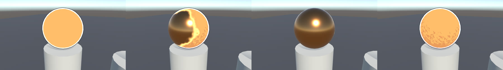

# 验证与性能

[← 文档首页](README.md) · 相关：[三个尺度的反馈](FEEDBACK.md) · [工具链](TOOLS.md)

## 1. 三层验证

| 层级 | 检查什么 | 方法 | 状态 |
|---|---|---|---|
| 配置审计 | ID、引用、层级、材质族、声音是否一致 | 只读审计工具导出文本，见 [工具链](TOOLS.md#35-审计用文本对照配置) | 已建立 |
| 状态测试 | 揭示、放置、整房恢复的状态变化 | PlayMode 测试 | 已建立，6/6 通过 |
| 头显验收 | 双眼视觉、交互尺度、音画反馈、帧耗时 | 真机试玩 + Profiler | **未完成**（没有头显） |

## 2. PlayMode 测试

| 测试 | 覆盖范围 |
|---|---|
| `RevealLaserPlayModeTests.LaserRevealsTargetThenRetreats` | 射线命中后半径增长，移开后回退，属性块被清理 |
| `Room1PuzzlePlayModeTests.PatchThenPlaceThenFinale` | 一号房：局部探索 → 切换目标、前一件退回 → 放置 → 整房恢复 |
| `Room1PuzzlePlayModeTests.GongbiV2_PatchThenPlaceThenFinale` | 同上，在工笔第二版场景中执行 |
| `Room23PlayModeTests.Room2_MatchesRoom1` | 二号房（4 件）：槽位、放置与完成反馈和一号房一致 |
| `Room23PlayModeTests.Room3_MatchesRoom1` | 三号房（6 件）：同上 |
| `GongbiV2PlayModeTests.NewMaterialsSurvivePlacementAndCompletion` | 三个房间共 18 件：放置和完成过程中材质不被覆盖，碰撞体正确，完成状态正确 |

测试直接加载场景副本，用代码模拟射线命中和放置，然后检查 Shader 属性、`IsCorrect`、`IsCompleted` 和 [控制权表](FEEDBACK.md#4-控制权一览) 中的状态。关键步骤会截图，作为视觉对照。

### 最近一次执行

| 项 | 内容 |
|---|---|
| 日期 | 2026-11-15 |
| 环境 | Unity 6000.0.59f2，Windows，batch mode（`-runTests -testPlatform PlayMode`） |
| 结果 | 6 个测试，**6 通过**，0 失败，0 跳过 |
| 总耗时 | 78.7 s |
| 原始结果 | [playmode-results-20261115.xml](evidence/tests/playmode-results-20261115.xml) |

| 测试 | 耗时 |
|---|---:|
| GongbiV2 · NewMaterialsSurvivePlacementAndCompletion | 12.8 s |
| RevealLaser · LaserRevealsTargetThenRetreats | 7.8 s |
| Room1Puzzle · PatchThenPlaceThenFinale | 19.5 s |
| Room1Puzzle · GongbiV2_PatchThenPlaceThenFinale | 18.7 s |
| Room23 · Room2_MatchesRoom1 | 9.6 s |
| Room23 · Room3_MatchesRoom1 | 10.3 s |

测试耗时主要来自场景加载和等待揭示动画完成，不代表运行时性能。

## 3. 性能取舍

运行时参数通过 `MaterialPropertyBlock` 写入，不为每个命中状态复制材质；Shader 属性 ID 预先缓存；局部状态消退后立即移除；可选功能用 `shader_feature` 开关。

| 实现 | 收益 | 成本或边界 |
|---|---|---|
| 双路径光照混合 | 过渡连续，接口统一 | 片元阶段同时计算两套光照 |
| 三平面纹理 | 不依赖 UV | 采样次数增加 |
| 三层程序噪声 | 边界更有变化 | 片元运算增加 |
| 环境物体用轻量 Shader | 片元开销集中在器物上 | 两套 Shader 的色彩需要手动对齐 |
| 新组件接管属性，不改原脚本 | 迭代风险低 | 每帧多一次射线查询 |
| 完成时扫描 Renderer | 场景接入直接 | 大场景需评估扫描峰值 |
| 完成后持续写属性 | 保持控制权 | 可以改为完成后停止更新 |
| 消退时清空属性块 | 实现简单 | 以后如果多个组件共用属性块，需要统一属性的归属 |

**我不报告未经测量的帧率、Draw Call 或 GPU 耗时。** 项目只在编辑器和 XR Device Simulator 中运行过，这些数据不代表头显上的表现。

## 4. 已知边界与待验证项

| 项 | 说明 |
|---|---|
| 真机性能 | 需要在目标头显上分别采集空闲、探索、多物体同时消退、整房恢复四种情况的 CPU/GPU 帧时间，并用 Frame Debugger 检查批处理 |
| 双眼一致性 | 代码层面已处理（视深描边、世界空间遮罩、立体渲染宏），需要真机确认没有边缘闪烁 |
| 房间盒旋转 | 整房恢复的房间范围计算假设房间盒没有旋转 |
| 平铺接缝 | 图案较大的贴图在过渡带能看到重复，需要按实际观看距离验收 |
| 交互尺度 | 抓取尺寸（12 cm）和吸附距离（30 cm）在模拟器中调定，需要真机试玩确认 |
